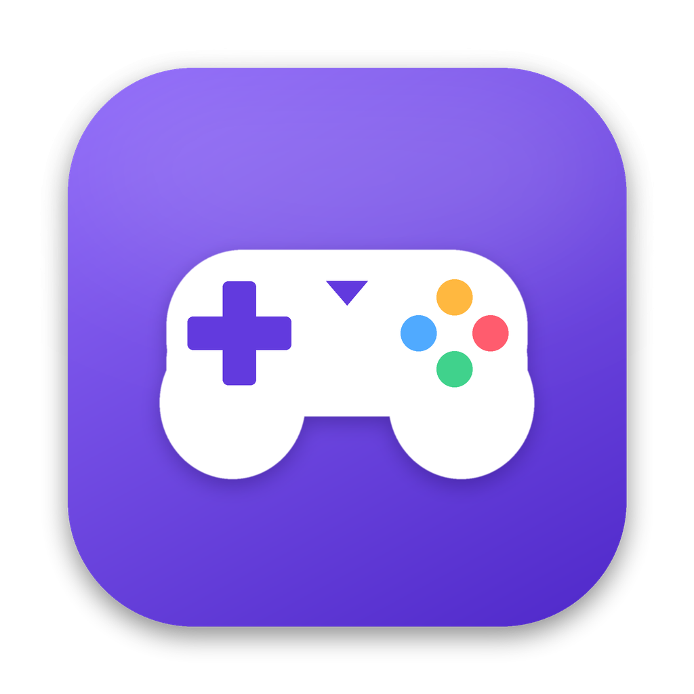

<p align="center">
  
</p>

<h1 align="center">PadPilot</h1>

<p align="center">
  Map any game controller to keyboard, mouse, clicks and scrolling on macOS.<br>
  Play games without controller support, or drive any app from the couch.
</p>

<p align="center">
  <a href="https://github.com/zwillianmattos/padpilot/actions/workflows/ci.yml"></a>
  <a href="https://github.com/zwillianmattos/padpilot/releases/latest"></a>
  <a href="LICENSE"></a>
</p>

<p align="center">
  <a href="https://zwillianmattos.github.io/padpilot/">Website</a> ·
  <a href="https://github.com/zwillianmattos/padpilot/releases/latest">Download</a>
</p>

---

## Features

- **Map anything to anything.** Buttons, D-pad, each direction of both sticks, and triggers (with an adjustable threshold) become keys, shortcuts such as ⌘Q, mouse movement, clicks or scrolling.
- **Smooth mouse.** A 120 Hz native loop with radial dead zone, response curve (linear, quadratic, exponential) and separate speeds for up, down, left and right.
- **Visual editor.** Click a point on a photo of your controller (Xbox or DualSense layout), or press the button on the controller to jump to it. Keys are recorded straight from the keyboard.
- **Profiles.** Ready-made FPS, Media Player, Browsing and Photo editing profiles. Create, duplicate, import and export them as JSON.
- **Game hub.** Your Steam library in rows: games that need PadPilot, games that are ready, games with native controller support. Bind a profile to a game, and it switches automatically when the game comes to the front.
- **Stick diagnostics.** Circularity, edge reach, center offset, noise, resolution and raw HID values. Useful for checking hall-effect stick mods.
- **Menu bar app.** Mapping keeps running with the window closed. Toggle it with a global shortcut, and switch profiles from the menu.
- **English, Portuguese and Spanish.** Light and dark themes follow the system.

## Supported controllers

Xbox One/Series, DualShock 4, DualSense, Switch Pro and MFi controllers work through Apple's GameController framework, over USB or Bluetooth, with no driver. Generic HID joysticks work through IOKit and need the Input Monitoring permission.

## Requirements

- macOS 13 Ventura or later.
- **Accessibility** permission, to simulate keyboard and mouse input.
- **Input Monitoring** permission, only for generic HID joysticks and the raw HID view in diagnostics. macOS applies it after the app restarts.

Windows builds are a preview: the interface, profiles and game hub run, but the controller engine is macOS-only for now.

## Install

1. Download `PadPilot-<version>-macos.dmg` from the [latest release](https://github.com/zwillianmattos/padpilot/releases/latest).
2. Drag PadPilot to Applications.
3. If the build isn't notarized, right-click the app and choose **Open** the first time.
4. Follow the onboarding to grant the permissions.

## Build from source

Requires Flutter 3.35, Xcode 15 or later and CocoaPods.

```sh
flutter pub get
flutter run -d macos
flutter test
flutter build macos --release
```

Debug builds are ad-hoc signed, so macOS treats every rebuild as a new app and the permissions must be granted again. Sign with your Apple Development team in Xcode to keep them between builds.

## Architecture

```
Flutter (Dart)                         Native plugin (Swift, macOS)
UI · profiles · editor · settings      ControllerInput  GameController + IOHIDManager
        │                              MappingEngine    applies the active profile
        │  MethodChannel  wanmind/padpilot                         │
        │  EventChannel   wanmind/padpilot/events                  ▼
        └──────────────────────────────▶ EventInjector    CGEvent keyboard/mouse/scroll
                                         MouseMotionLoop  120 Hz smooth movement
                                         PermissionManager, HotkeyManager, Keychain
```

The active profile is sent to Swift once. From then on, mapping runs entirely in native code, with no round trip to Dart per input. This keeps latency low and lets mapping continue while the window is closed. Dart receives input events only for capture mode, the live viewer and diagnostics.

| Path | Contents |
|---|---|
| `lib/core` | Platform channel, storage, engine sync |
| `lib/models` | Profile, mapping, input and action models |
| `lib/features` | Screens: controllers, mapping editor, profiles, diagnostics, game hub, settings, onboarding, menu bar |
| `lib/l10n` | ARB translations (EN, PT, ES) |
| `macos/Runner` | Swift engine and plugin |
| `website` | GitHub Pages site |
| `tool` | Scripts that generate the app icon and controller cut-outs |

### Profile format

Profiles live in `~/Library/Application Support/br.com.wanmind.padpilot/profiles/*.json`:

```json
{
  "id": "fps-default",
  "name": "FPS",
  "mappings": [
    {
      "input": { "type": "stickDirection", "stick": "left", "direction": "up", "threshold": 0.4 },
      "action": { "type": "key", "keyCode": 13, "modifiers": [] }
    },
    {
      "input": { "type": "stickAxis", "stick": "right" },
      "action": {
        "type": "mouseMove",
        "speed": { "up": 12, "down": 12, "left": 14, "right": 14 },
        "deadzone": 0.15,
        "curve": "quadratic"
      }
    },
    {
      "input": { "type": "trigger", "trigger": "right", "threshold": 0.5 },
      "action": { "type": "mouseClick", "button": "left" }
    }
  ]
}
```

Input types: `button`, `dpad`, `stickDirection`, `stickAxis`, `trigger`. Action types: `key`, `mouseMove`, `mouseClick`, `scroll`. Key codes are macOS virtual key codes (physical key positions).

### Steam integration

The game hub reads installed games from the local Steam library, with no key needed. Store details and artwork come from Steam's public store endpoints and are cached on disk. Linking a Steam account is optional: it adds owned games and playtime through the [Steam Web API](https://steamcommunity.com/dev). The API key is stored in the macOS Keychain and sent only to Steam.

## CI/CD

| Workflow | Trigger | What it does |
|---|---|---|
| `ci.yml` | Push to `main`, pull requests | Analyze, test, and build the macOS DMG and Windows zip as artifacts |
| `release.yml` | Tag `v*` (for example `v0.2.0`) | Build both platforms and publish a GitHub Release |
| `pages.yml` | Changes in `website/` | Deploy the site to GitHub Pages |

To release:

```sh
git tag v0.1.0
git push origin v0.1.0
```

macOS signing and notarization run only when these repository secrets are set: `MACOS_CERTIFICATE` (base64 Developer ID `.p12`), `MACOS_CERTIFICATE_PASSWORD`, `MACOS_SIGNING_IDENTITY`, `APPLE_ID`, `APPLE_TEAM_ID`, `APPLE_APP_PASSWORD`. Without them, the DMG contains an ad-hoc signed app.

To enable the website, set **Settings › Pages › Source** to **GitHub Actions**.

## Known limitations

- Some games with anti-cheat or raw input reading ignore synthetic events.
- Other input mappers running at the same time can conflict.
- Wireless Xbox 360 controllers need Microsoft's receiver; they don't use Bluetooth.
- PS3 controllers over USB may need the PS button pressed once.
- Game auto-switch recognizes games by their Steam install folder, so games run through compatibility layers aren't detected.

## Roadmap

- Windows engine (XInput / Windows.Gaming.Input input, `SendInput` injection).
- Per-game overrides layered on a base profile.
- Playtime tracked with a controller connected.
- Automatic updates.

## License

[MIT](LICENSE) © 2026 Wanmind Innovation.

Xbox, PlayStation, DualSense, DualShock, Nintendo Switch and Steam are trademarks of their respective owners. PadPilot is not affiliated with or endorsed by them.
